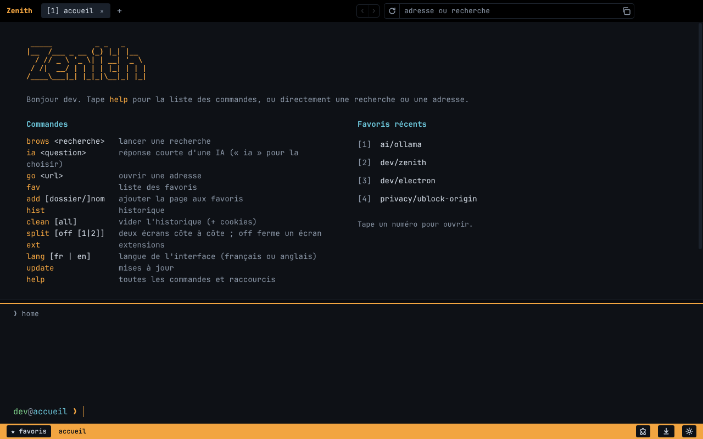

# dev-brows

[English](README.md) · **Français**

Un navigateur basé sur Chromium (Electron) qui se pilote comme un terminal. Les sites s'affichent normalement et restent cliquables à la souris ; le terminal reste en dessous pour taper des commandes.



## Installer

Les installateurs sont sur la page [Releases](https://github.com/Rycrem/dev-brows/releases/latest) :

- Windows : `dev-brows-Setup-x.y.z.exe`. L'installateur demande la langue de l'appli (français ou anglais) et, sur sa page Confidentialité, si l'appli peut chercher les mises à jour toute seule. L'installateur n'est pas signé : Windows SmartScreen affiche « Windows a protégé votre ordinateur » : cliquer sur « Informations complémentaires » › « Exécuter quand même ». Le Contrôle intelligent des applications de Windows 11, lui, bloque un installateur non signé sans proposer d'exception.
- macOS : `.dmg` (`arm64` pour les Mac Apple Silicon, `x64` pour les Mac Intel). L'appli n'est pas signée : au premier lancement, clic droit sur l'appli › Ouvrir.
- Linux : `.AppImage` (le rendre exécutable puis le lancer) ou `.deb`.

**Désinstaller :** sous Windows, Paramètres › Applications › Applications installées › dev-brows › Désinstaller. Sous macOS, glisser dev-brows des Applications vers la Corbeille. Sous Linux, supprimer le `.AppImage`, ou `sudo apt remove dev-brows` pour le `.deb`. Tes données restent dans le dossier indiqué dans « Données » tant que tu ne le supprimes pas.

## Langue

dev-brows parle français et anglais. `lang` affiche la langue, `lang fr` ou `lang en` la change tout de suite. La première fois, l'appli prend la langue choisie dans l'installateur Windows, sinon celle du système (français si le système est en français, anglais sinon).

## Lancer depuis le code

```bash
npm install
npm start
```

Tests de la logique (favoris, alias, lecture des résultats, extensions) : `npm test`. `npm run ublock` télécharge uBlock Origin dans `vendor/` pour qu'il soit préinstallé au lancement. `npm run dist` le fait aussi, puis construit l'installateur du système courant dans `dist/`.

## Commandes

| Commande | Effet |
| --- | --- |
| `brows <recherche>` | recherche, résultats numérotés (DuckDuckGo par défaut) |
| `ia <question>` | réponse courte de l'IA choisie (Claude avec recherche web et sources numérotées) |
| `ia`, `ia use <ia>`, `ia key <clé>`, `ia logout`, `ia model [id]` | choisir et connecter l'IA |
| `<n>` / `<n>t` | ouvre l'élément n de la liste affichée, `t` pour un nouvel onglet |
| `go <url>` | ouvre une adresse (taper directement une adresse marche aussi) |
| `links` | numérote les liens et boutons de la page, puis tape un numéro |
| `tty [on\|off]` | affiche les pages en texte simple, comme un terminal : liens soulignés en bleu et numérotés, tape le numéro ou clique dessus (reste actif pendant la navigation) |
| `back`, `fwd`, `reload`, `home` | navigation |
| `tab`, `tab <n>`, `tab new [url…]`, `tab save <nom>`, `close [n]` | onglets (`tab new` avec plusieurs adresses ouvre un onglet pour chacune) |
| `split`, `split off [1\|2]`, `focus` | deux écrans côte à côte, fermer un écran (l'autre par défaut, ou le ✕ en haut de l'écran), changer d'écran |
| `fav [dossier]` | favoris en arbre |
| `add [dossier/]nom` | ajoute la page, crée les dossiers manquants |
| `fav rm <chemin\|n>`, `fav mv <chemin> <dest>`, `fav rename <chemin> <nom>`, `undo` | gérer les favoris |
| `fav import [chrome\|edge\|brave\|vivaldi\|opera\|firefox\|fichier\|<fichier>]` | importe les favoris d'un autre navigateur de cet ordinateur, ou d'un export HTML (`fav import fichier` ouvre un sélecteur) ; ils arrivent dans un dossier au nom du navigateur, sans doublons |
| `hist [texte]` | historique, filtrable |
| `clean`, `clean all` | vide l'historique ; `all` vide aussi cookies et cache (avec confirmation) |
| `find [texte]` | chercher dans la page |
| `ext`, `ext add <lien store \| id \| dossier>`, `ext on/off/rm <n>`, `ext alias <n> <nom>`, `ext <n>`, `ext log <n>` | extensions (`ext log` montre les erreurs et avertissements d'une extension depuis le lancement, pour savoir pourquoi elle ne marche pas) |
| `dl [n]` | téléchargements (enregistrés directement dans Téléchargements) |
| `alias nom = commande [; commande…]`, `unalias nom` | raccourcis perso, qui peuvent enchaîner des commandes |
| `adblock [on\|off]` | bloqueur de pub de secours, éteint par défaut (uBlock Origin est préinstallé) |
| `engine ddg\|google\|bing\|qwant`, `theme ambre\|vert\|cyan\|rose\|violet`, `lang [fr\|en]` | réglages |
| `perm`, `perm reset [site]` | autorisations données aux sites |
| `update`, `update install`, `update -v [version]`, `update electron`, `update auto [on\|off]` | mises à jour (voir plus bas) |
| `devtools [detach\|close]`, `term`, `fullscreen [on\|off]`, `quit` (ou `exit`, `q`), `help`, `clear` | divers (DevTools : à côté de la page, dans une fenêtre, ou fermées ; boutons aussi dans la barre d'état ; `quit` ferme le navigateur) |

Tout ce qui n'est ni une commande, ni un alias, ni une adresse lance une recherche ; une adresse (`exemple.fr`, `localhost:3000`) s'ouvre directement. Une commande suivie de mots qu'elle n'attend pas (« home depot », « close friends ») est aussi une recherche.

**Groupes d'onglets :** `tab save travail` crée l'alias `travail`, qui rouvre tous les onglets ouverts. À la main : `alias travail = tab new gmail.com github.com`, ou avec plusieurs commandes séparées par `;` (`alias matin = tab new meteo.fr ; split ; ia actus`).

Les questions oui/non répondent oui quand on appuie sur Entrée (`(O/n)`), sauf `clean all`, qui efface cookies et cache sans retour possible (`(o/N)`). Taper une autre commande vaut non.

Après une commande, le clavier reste dans le terminal, même quand une page se charge ; Échap ou un clic dans la page lui donne la main.

Chaque onglet a son propre terminal ; l'historique des commandes (↑ ↓) est commun à tous.

## Raccourcis

Ctrl+L terminal · Ctrl+J cacher/montrer le terminal · F11 plein écran · Échap rendre la main à la page · Ctrl+T / Ctrl+W onglets · Ctrl+Tab, Ctrl+1…9 · Alt+←/→ · F5 · Ctrl+F chercher · Ctrl+D favori · Ctrl+Maj+S split · F6 changer d'écran · F12 ou clic droit › Inspecter pour les DevTools · Alt+1…9 popup d'extension · Ctrl+Maj+B popup des favoris · Ctrl+Maj+J popup des téléchargements · ↑/↓ historique des commandes · Tab autocomplétion.

À la souris : un clic sur l'adresse en haut à droite la copie, le + ouvre un onglet, le zoom s'affiche dans la barre d'état quand il n'est pas à 100 % (clic pour revenir à 100 %), et la barre au-dessus des DevTools les détache (⇱) ou les ferme (✕). La barre entre la page et le terminal se glisse pour changer sa hauteur (double-clic pour revenir à la taille par défaut), la barre entre les deux écrans du split aussi. Les onglets, résultats, favoris et pastilles d'extensions sont cliquables (Ctrl+clic pour un nouvel onglet). Dans la barre d'état, ★ favoris (en bas à gauche) ouvre tes favoris en popup avec un filtre (tape, ↑/↓, Entrée), et ↓ (à droite des pastilles d'extensions) ouvre la popup des téléchargements, avec une roue de progression, le poids, la vitesse et le temps restant de chacun. Un onglet qui joue du son affiche un haut-parleur : un clic coupe son son. Pendant qu'une musique ou une vidéo joue, un player prend la place de l'heure : son curseur règle le volume de tout le navigateur, et un clic sur sa barre de son ouvre une popup pour contrôler chaque onglet (lecture/pause, muet, volume). Un second clic sur la pastille d'une extension ferme sa popup. Clic molette sur un onglet pour le fermer, glisser-déposer pour changer leur ordre. Dans le terminal, le clic droit copie le texte sélectionné, ou colle le presse-papier dans la ligne de commande s'il n'y a pas de sélection.

## Extensions

Sur le Chrome Web Store, le bouton « Ajouter à Chrome » est grisé hors de Chrome : sur la page de l'extension, tape simplement `ext add` (le terminal le rappelle). `ext add` accepte aussi un lien du Chrome Web Store, un identifiant d'extension ou un dossier d'extension décompressée. Chaque extension a une pastille numérotée dans la barre d'état ; un clic ou Alt+n ouvre sa popup. Electron ne gère qu'une partie des API d'extensions Chrome ; la bibliothèque [electron-chrome-extensions](https://github.com/samuelmaddock/electron-browser-shell/tree/master/packages/electron-chrome-extensions) ajoute les onglets, fenêtres, notifications, cookies et permissions (une extension peut par exemple ouvrir un onglet). Les bloqueurs de pub et scripts de contenu fonctionnent bien ; certaines extensions plus poussées peuvent encore ne pas marcher.


**Bloqueur de pub :** [uBlock Origin](https://github.com/gorhill/uBlock) est préinstallé (pastille 1 dans la barre d'état, Alt+1 pour sa popup). L'installateur embarque la dernière version publiée au moment de sa construction ; `ext add ublock` la remplace par la toute dernière. Si on le supprime avec `ext rm`, il n'est pas réinstallé. uBlock Origin Lite, la version du Chrome Web Store, bloque avec `declarativeNetRequest`, qu'Electron ne gère pas : elle ne bloque rien ici, et `ext` le signale.

`adblock on` allume un bloqueur de secours intégré (moteur de [Ghostery](https://github.com/ghostery/adblocker), listes EasyList et EasyPrivacy). Electron n'accepte qu'un filtre de requêtes à la fois : tant qu'il est allumé, uBlock Origin ne filtre plus. Il est donc éteint par défaut, et installer uBlock l'éteint.

## IA

`ia <question>` affiche une réponse de quelques phrases écrite par l'IA choisie. `ia` tout seul affiche la liste des IA : tape un numéro pour en choisir une. Si elle n'a pas encore de clé, la page où la créer s'ouvre ; copie la clé puis tape `ia key <clé>`.

| IA | Modèle par défaut | Prix |
| --- | --- | --- |
| Claude (Anthropic) | `claude-opus-5-5`, avec recherche web et sources numérotées | payant à l'usage |
| Gemini (Google AI Studio) | `gemini-3.8-flash` | gratuit, avec une limite par jour |
| ChatGPT (OpenAI) | `gpt-5-mini` | payant à l'usage |
| Mistral AI | `mistral-small-latest` | gratuit (offre Experiment) |
| Groq | `openai/gpt-oss-120b` | gratuit, avec une limite par jour |
| OpenRouter | `openrouter/free` (choisit un modèle gratuit) | gratuit, avec une limite par jour |
| Ollama | `llama3.2`, sur ton ordinateur | gratuit, sans clé ([ollama.com](https://ollama.com), puis `ollama pull llama3.2`) |

- `ia connect <ia> <clé>` choisit l'IA et enregistre sa clé en une fois.
- `ia model <id>` change le modèle de l'IA actuelle (`ia model default` revient au modèle par défaut). Quand une IA retire un modèle, dev-brows passe tout seul à son modèle actuel (celui que conseille l'IA, sinon la version la plus récente de la même famille) et s'en souvient.
- `ia logout [ia]` supprime la clé enregistrée, par exemple avant de prêter l'ordinateur.

Chaque clé reste sur cet ordinateur, chiffrée par le système quand c'est possible, et n'apparaît ni à l'écran ni dans l'historique des commandes. Personne d'autre qui installe l'appli n'utilise ta clé. Les variables `ANTHROPIC_API_KEY`, `GEMINI_API_KEY`, `OPENAI_API_KEY`, `MISTRAL_API_KEY`, `GROQ_API_KEY` et `OPENROUTER_API_KEY` marchent aussi. Seul Claude fait des recherches web ; les autres répondent avec ce qu'ils savent.

## Mises à jour

Une vérification se fait à chaque lancement (`update auto off` la coupe) ; `update` la lance à la demande. Au même moment, les extensions installées depuis le Chrome Web Store et uBlock Origin sont mises à jour toutes seules quand une nouvelle version existe (le terminal l'affiche). Les extensions ajoutées depuis un dossier ne sont pas touchées.

**Appli installée** (depuis un installateur des Releases) :

- `update` compare la version installée avec la dernière Release GitHub et signale quand un nouvel installateur est publié, avec un récapitulatif de ce qu'apporte chaque version depuis la tienne.
- `update -v` liste les versions publiées ; tape un numéro pour lire les notes de cette version dans le terminal, puis l'installer si tu veux (même une plus ancienne). `update -v 0.1.12` va directement à cette version.
- `update install` télécharge le nouvel installateur, l'applique et relance l'appli. Sur macOS (appli non signée, la mise à jour automatique y est impossible), il ouvre la page de la Release pour télécharger le `.dmg`.
- Electron et Chromium sont livrés avec l'installateur : chaque nouvelle Release les met à jour.

**Lancée depuis le code** (`npm start`) :

- `update` vérifie la version d'Electron (et donc de Chromium) et les nouveaux commits du dépôt.
- `update install` récupère le code (`git pull`), puis met à jour les dépendances sans changer de version majeure d'Electron : ce sont les correctifs de sécurité, sans risque de casse.
- `update electron` passe à la toute dernière version majeure d'Electron, à tester.

L'appli se ferme, la mise à jour se fait avec le `node` du système (sous Windows, Electron ne peut pas être remplacé pendant qu'il tourne), puis elle se relance et affiche le compte rendu dans le terminal.

## Sécurité

- Chaque site tourne dans le bac à sable de Chromium, sans accès à Node ni à l'ordinateur.
- Caméra, micro, position, notifications, presse-papier, partage d'écran, ouverture d'applications externes : chaque demande d'un site pose la question dans le terminal (Entrée ou `o` oui, `t` toujours, `j` jamais, `n` non). `perm` liste les choix enregistrés.
- La version de Chromium est celle d'Electron : faire `update install` quand l'appli le signale pour recevoir les correctifs de sécurité.
- Connexion Google : Google refuse les navigateurs basés sur Electron (« Ce navigateur ou cette application ne sont peut-être pas sécurisés »). Sur `accounts.google.com` uniquement, dev-brows se présente donc comme Firefox ; pendant cette connexion, uBlock Origin est en pause (Electron ne laisse pas les deux filtrer les requêtes en même temps). Google peut bloquer cette parade à tout moment.
- Clés de sécurité (YubiKey et autres clés FIDO2) : la connexion passe par la fenêtre du système (Windows Hello sous Windows). Si la clé garde plusieurs comptes pour le site, le terminal demande lequel utiliser.
- Pas de protection anti-hameçonnage (navigation sécurisée de Google) comme dans Chrome.

## Données

Favoris, historique et réglages sont des fichiers JSON dans le dossier de données d'Electron (`~/.config/dev-brows` sous Linux, `%APPDATA%\dev-brows` sous Windows, `~/Library/Application Support/dev-brows` sous macOS).

Lancée depuis le code, l'appli utilise un dossier à part, `dev-brows-dev` (copié depuis `dev-brows` la première fois) : l'appli installée chiffre ses cookies avec une clé que la version de développement ne peut pas relire.

## Confidentialité

dev-brows ne collecte aucune donnée sur toi et n'a pas de télémétrie. En dehors des sites que tu ouvres, il ne se connecte tout seul qu'à :

- GitHub (`github.com`, `api.github.com`), à chaque lancement, pour chercher une nouvelle version de dev-brows et de uBlock Origin ;
- le service de mise à jour du Chrome Web Store (`clients2.google.com`), à chaque lancement, pour les extensions installées depuis le store.

Ces vérifications se coupent dans l'installateur Windows (case de la page Confidentialité, affichée pendant l'installation) ou à tout moment avec `update auto off` ; `update` marche toujours à la demande.

Le reste ne se fait que quand tu le demandes, vers un service que tu as choisi et selon sa propre politique de confidentialité : le moteur de recherche (`engine`), l'IA choisie (`ia <question>`, avec ta question), les serveurs des listes de filtres de [uBlock Origin](https://github.com/gorhill/uBlock/wiki/Privacy-policy) et du bloqueur de secours, et les extensions que tu installes.

## Licence

GPL-3.0 ou ultérieure (voir [LICENSE](LICENSE)), à cause de la bibliothèque electron-chrome-extensions, distribuée sous GPL-3.0.
