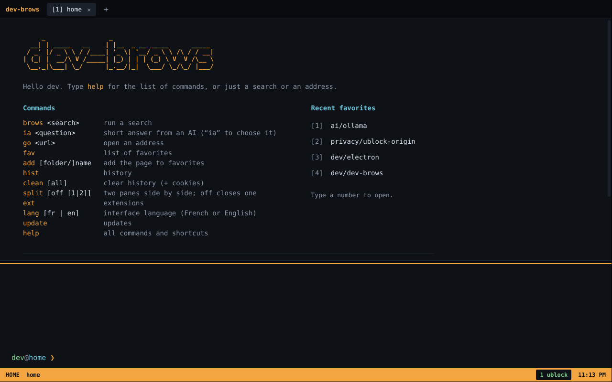
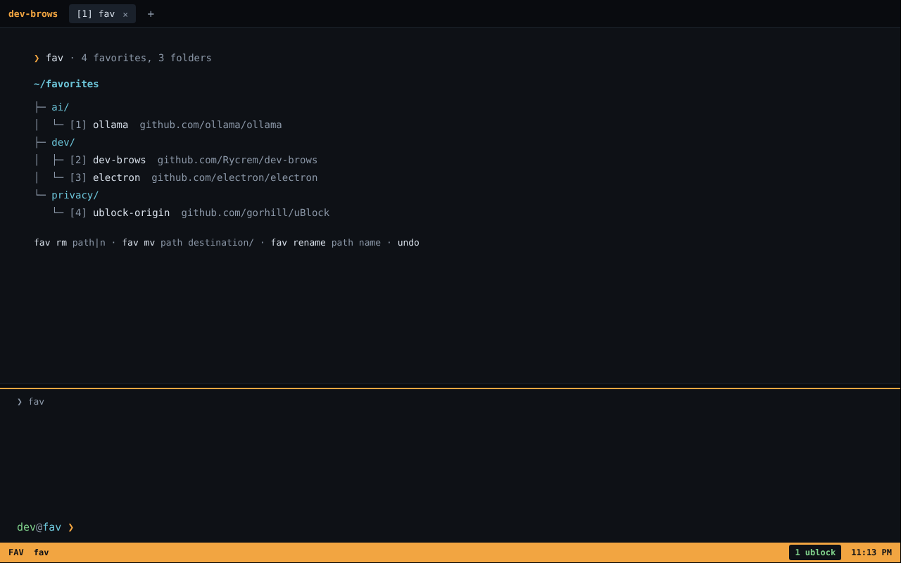
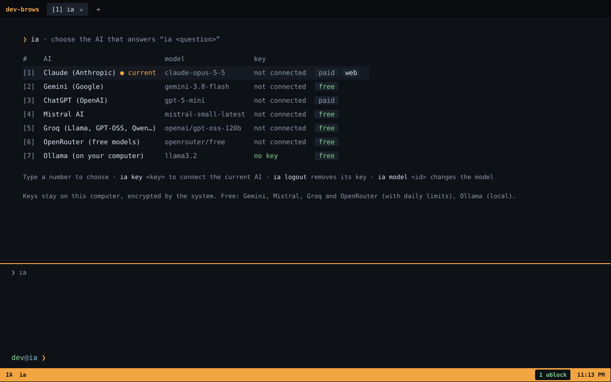
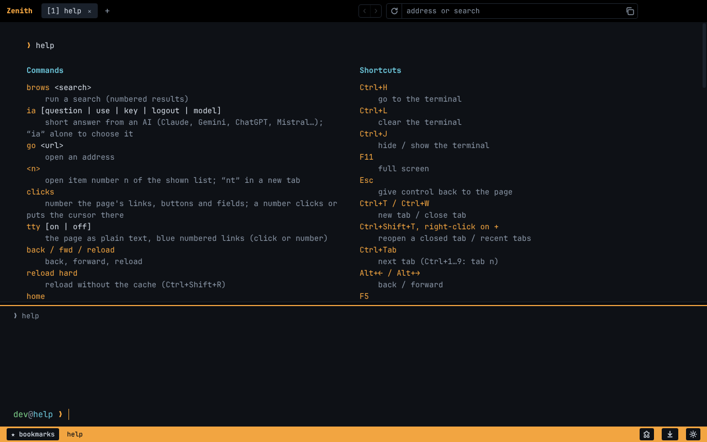

# dev-brows

**English** · [Français](README.fr.md)

A Chromium-based browser (Electron) that you drive like a terminal. Websites display normally and stay clickable with the mouse; the terminal stays below the page for typing commands.



| | |
| --- | --- |
|  |  |
| `fav`: bookmarks as a tree, type a number to open one | `ia`: pick the AI that answers `ia <question>` |



## Language

dev-brows speaks English and French. `lang` shows the current language, `lang en` or `lang fr` switches it right away. The first time, the app uses the language picked in the Windows installer, or else the system language (French if the system is in French, English otherwise).

## Run from source

```bash
npm install
npm start
```

Logic tests (bookmarks, aliases, result parsing, extensions, translations): `npm test`. `npm run ublock` downloads uBlock Origin into `vendor/` so it is preinstalled at launch. `npm run dist` does that too, then builds the installer for the current OS into `dist/`.

## Publishing a version

1. Change `version` in `package.json` (for example `0.2.0`), add its notes at the top of `src/shared/changelog.js` in French and English (shown on the home screen; `npm test` checks it), and push to `main`.
2. Run the GitHub Actions workflow "Installateurs" (Actions tab › Installateurs › Run workflow), or push the matching tag (`git tag v0.2.0 && git push origin v0.2.0`).

The workflow builds the Windows, macOS and Linux installers, attaches them to a `v0.2.0` Release and publishes it. That Release is what the installed app finds with `update`.

For Windows only, run the "Installateur Windows" workflow instead (Actions tab › Installateur Windows › Run workflow): it builds only the `.exe` and publishes it in the `v<version>` Release, faster. Installed macOS and Linux apps will not see that version as an update.

## Commands

| Command | What it does |
| --- | --- |
| `brows <search>` | search, numbered results (DuckDuckGo by default) |
| `ia <question>` | short answer from the chosen AI (Claude with web search and numbered sources) |
| `ia`, `ia use <ai>`, `ia key <key>`, `ia logout`, `ia model [id]` | choose and connect the AI |
| `<n>` / `<n>t` | opens item n of the list on screen, `t` for a new tab |
| `go <url>` | opens an address (typing an address directly works too) |
| `links` | numbers the page's links and buttons, then type a number |
| `back`, `fwd`, `reload`, `home` | navigation |
| `tab`, `tab <n>`, `tab new [url…]`, `tab save <name>`, `close [n]` | tabs (`tab new` with several addresses opens a tab for each) |
| `split`, `split off [1\|2]`, `focus` | two panes side by side, close a pane (the other one by default, or the ✕ at the top of the pane), switch pane |
| `fav [folder]` | bookmarks as a tree |
| `add [folder/]name` | bookmarks the page, creating missing folders |
| `fav rm <path\|n>`, `fav mv <path> <dest>`, `fav rename <path> <name>`, `undo` | manage bookmarks |
| `hist [text]` | history, filterable |
| `clean`, `clean all` | clears history; `all` also clears cookies and cache (asks first) |
| `find [text]` | find in page |
| `ext`, `ext add <store link \| id \| folder>`, `ext on/off/rm <n>`, `ext alias <n> <name>`, `ext <n>` | extensions |
| `dl [n]` | downloads (saved straight to Downloads) |
| `alias name = command [; command…]`, `unalias name` | your own shortcuts, which can chain commands |
| `adblock [on\|off]` | fallback ad blocker, off by default (uBlock Origin is preinstalled) |
| `engine ddg\|google\|bing\|qwant`, `theme ambre\|vert\|cyan\|rose\|violet`, `lang [en\|fr]` | settings |
| `perm`, `perm reset [site]` | permissions given to sites |
| `update`, `update install`, `update electron`, `update auto [on\|off]` | updates (see below) |
| `devtools [detach\|close]`, `term`, `fullscreen [on\|off]`, `quit` (or `exit`, `q`), `help`, `clear` | misc (DevTools: next to the page, in a window, or closed; also buttons in the status bar; `quit` closes the browser) |

Anything that is not a command, an alias or an address runs a search; an address (`example.com`, `localhost:3000`) opens directly. A command followed by words it does not expect ("home depot", "close friends") is a search too.

**Tab groups:** `tab save work` creates the alias `work`, which reopens all the open tabs. By hand: `alias work = tab new gmail.com github.com`, or with several commands separated by `;` (`alias morning = tab new weather.com ; split ; ia news`).

Yes/no questions answer yes when you press Enter (`(Y/n)`), except `clean all`, which deletes cookies and cache for good (`(y/N)`). Typing another command means no.

After a command, the keyboard stays in the terminal, even while a page loads; Esc or a click in the page hands it over.

Each tab has its own terminal; command history (↑ ↓) is shared by all of them.

## Shortcuts

Ctrl+L terminal · Ctrl+J hide/show the terminal · F11 fullscreen · Esc hand over to the page · Ctrl+T / Ctrl+W tabs · Ctrl+Tab, Ctrl+1…9 · Alt+←/→ · F5 · Ctrl+F find · Ctrl+D bookmark · Ctrl+Shift+S split · F6 switch pane · F12 or right-click › Inspect for DevTools · Alt+1…9 extension popup · ↑/↓ command history · Tab completion.

With the mouse: clicking the address at the top right copies it, + opens a tab, the zoom level shows in the status bar when it is not 100% (click it to go back to 100%), and the bar above DevTools detaches them (⇱) or closes them (✕). The bar between the page and the terminal can be dragged to change its height (double-click for the default size), and so can the bar between the two split panes. Tabs, results, bookmarks and extension badges are clickable (Ctrl+click for a new tab). Middle-click a tab to close it, drag and drop to reorder. In the terminal, right-click copies the selected text, or pastes the clipboard into the command line when nothing is selected.

## Extensions

On the Chrome Web Store, the "Add to Chrome" button is greyed out outside Chrome: on the extension's page, just type `ext add` (the terminal reminds you). `ext add` also takes a Chrome Web Store link, an extension id or an unpacked extension folder. Each extension has a numbered badge in the status bar; a click or Alt+n opens its popup. Electron supports only part of the Chrome extension APIs; the [electron-chrome-extensions](https://github.com/samuelmaddock/electron-browser-shell/tree/master/packages/electron-chrome-extensions) library adds tabs, windows, notifications, cookies and permissions (an extension can open a tab, for instance). Ad blockers and content scripts work well; some more advanced extensions may still not work.

**Ad blocker:** [uBlock Origin](https://github.com/gorhill/uBlock) is preinstalled (badge 1 in the status bar, Alt+1 for its popup). The installer ships the latest version published when it was built; `ext add ublock` replaces it with the very latest. If you remove it with `ext rm`, it is not reinstalled. uBlock Origin Lite, the Chrome Web Store version, blocks with `declarativeNetRequest`, which Electron does not support: it blocks nothing here, and `ext` says so.

`adblock on` turns on a built-in fallback blocker ([Ghostery](https://github.com/ghostery/adblocker)'s engine, EasyList and EasyPrivacy lists). Electron accepts only one request filter at a time: while it is on, uBlock Origin no longer filters. So it is off by default, and installing uBlock turns it off.

## AI

`ia <question>` shows a few sentences written by the chosen AI. `ia` alone lists the AIs: type a number to pick one. If it has no key yet, the page to create one opens; copy the key, then type `ia key <key>`.

| AI | Default model | Price |
| --- | --- | --- |
| Claude (Anthropic) | `claude-opus-5-5`, with web search and numbered sources | pay as you go |
| Gemini (Google AI Studio) | `gemini-3.8-flash` | free, with a daily limit |
| ChatGPT (OpenAI) | `gpt-5-mini` | pay as you go |
| Mistral AI | `mistral-small-latest` | free (Experiment plan) |
| Groq | `openai/gpt-oss-120b` | free, with a daily limit |
| OpenRouter | `openrouter/free` (picks a free model) | free, with a daily limit |
| Ollama | `llama3.2`, on your computer | free, no key ([ollama.com](https://ollama.com), then `ollama pull llama3.2`) |

- `ia connect <ai> <key>` picks the AI and saves its key in one go.
- `ia model <id>` changes the current AI's model (`ia model default` goes back to the default). When an AI retires a model, dev-brows switches on its own to the current one (the one the AI recommends, or else the newest version of the same family) and remembers it.
- `ia logout [ai]` deletes the saved key, for example before lending the computer.

Each key stays on this computer, encrypted by the system when possible, and never appears on screen or in the command history. Nobody else who installs the app uses your key. The `ANTHROPIC_API_KEY`, `GEMINI_API_KEY`, `OPENAI_API_KEY`, `MISTRAL_API_KEY`, `GROQ_API_KEY` and `OPENROUTER_API_KEY` variables work too. Only Claude searches the web; the others answer with what they know.

## Updates

A check runs at every launch (`update auto off` turns it off); `update` runs it on demand. At the same time, extensions installed from the Chrome Web Store and uBlock Origin update themselves when a new version exists (the terminal says so). Extensions added from a folder are left alone.

**Installed app** (from a Releases installer):

- `update` compares the installed version with the latest GitHub Release and says when a new installer is out.
- `update install` downloads the new installer, applies it and restarts the app. On macOS (unsigned app, where automatic updates are impossible), it opens the Release page to download the `.dmg`.
- Electron and Chromium ship with the installer: each new Release updates them.

**Run from source** (`npm start`):

- `update` checks the Electron (and so Chromium) version and new commits in the repository.
- `update install` pulls the code (`git pull`), then updates dependencies without changing Electron's major version: security fixes, with no risk of breakage.
- `update electron` moves to the very latest major Electron version, to be tested.

The app closes, the update runs with the system's `node` (on Windows, Electron cannot be replaced while it runs), then it restarts and shows the report in the terminal.

## Security

- Each site runs in Chromium's sandbox, with no access to Node or the computer.
- Camera, microphone, location, notifications, clipboard, screen sharing, opening external apps: each request from a site asks in the terminal (Enter or `y` yes, `a` always, `x` never, `n` no). `perm` lists the saved choices.
- The Chromium version is Electron's: run `update install` when the app says so to get security fixes.
- Google sign-in: Google rejects Electron-based browsers ("This browser or app may not be secure"). On `accounts.google.com` only, dev-brows therefore presents itself as Firefox; during that sign-in, uBlock Origin is paused (Electron does not let both filter requests at the same time). Google may block this workaround at any time.
- Security keys (YubiKey and other FIDO2 keys): sign-in goes through the system dialog (Windows Hello on Windows). If the key holds several accounts for the site, the terminal asks which one to use.
- No anti-phishing protection (Google Safe Browsing) like in Chrome.

## Data

Bookmarks, history and settings are JSON files in Electron's data folder (`~/.config/dev-brows` on Linux, `%APPDATA%\dev-brows` on Windows, `~/Library/Application Support/dev-brows` on macOS).

Run from source, the app uses a separate folder, `dev-brows-dev` (copied from `dev-brows` the first time): the installed app encrypts its cookies with a key the development version cannot read.

## Privacy

dev-brows collects no data about you and has no telemetry. Besides the websites you open yourself, it connects on its own only to:

- GitHub (`github.com`, `api.github.com`), at every launch, to look for a new version of dev-brows and of uBlock Origin;
- the Chrome Web Store update service (`clients2.google.com`), at every launch, to look for new versions of the extensions installed from the store.

Those automatic checks can be turned off in the Windows installer (the privacy page, shown during installation, has a checkbox for them) or at any time with `update auto off`; `update` still works on demand.

Everything else happens only when you ask for it, and then goes to a service you chose, under that service's own privacy policy:

- the search engine you chose (`engine`), when you search;
- the AI you chose (`ia use`), when you type `ia <question>`, with your question;
- [uBlock Origin](https://github.com/gorhill/uBlock/wiki/Privacy-policy) and the fallback ad blocker (`adblock on`) download their filter lists from the lists' servers;
- the extensions you install, under their own privacy policies.

## License

GPL-3.0 or later (see [LICENSE](LICENSE)), because of the electron-chrome-extensions library, distributed under GPL-3.0.
